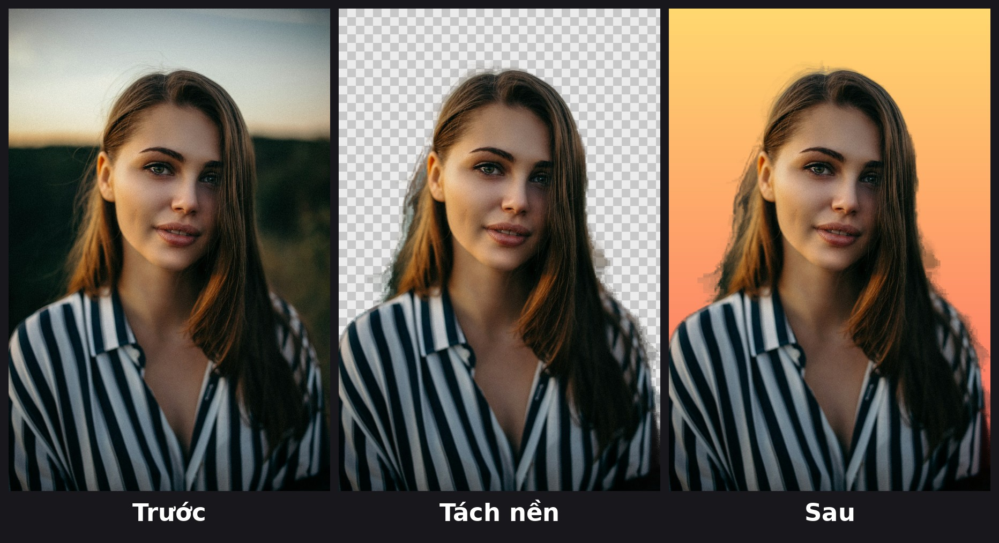

# ✂️ tachnen

**Tách nền ảnh ngay trên máy của bạn – miễn phí, không cần mạng, không giới hạn số ảnh.**

Đưa vào một tấm ảnh chân dung hoặc ảnh sản phẩm, vài giây sau bạn có:

1. **PNG nền trong suốt** – chỉ còn chủ thể, dùng ngay cho thiết kế, thumbnail, sticker.
2. **Ảnh nền mới** – chủ thể đặt trên nền màu trơn, nền làm mờ từ ảnh gốc (kiểu chụp xoá phông) hoặc nền chuyển màu.
3. **Ảnh so sánh Trước / Tách nền / Sau** – đăng mạng xã hội hoặc gửi khách xem là hiểu ngay.

Có cả **dòng lệnh (CLI)** để xử lý hàng loạt và **giao diện web nhỏ** chạy ở `localhost` cho người không quen terminal. Ảnh không bao giờ rời khỏi máy bạn.



## Cài đặt

Yêu cầu Python 3.10 trở lên.

```bash
git clone https://github.com/vietphan98/tachnen.git
cd tachnen
python -m venv .venv
source .venv/bin/activate          # Windows: .venv\Scripts\activate
pip install -e .
```

Lần chạy đầu tiên sẽ tự tải model tách nền (~180 MB) về thư mục `~/.u2net`. Sau đó mọi thứ chạy **offline hoàn toàn**.

## Cách dùng – dòng lệnh

```bash
# Nền làm mờ ảnh gốc (mặc định)
tachnen anh.jpg

# Nền màu trơn
tachnen anh.jpg --nen "#ffffff"

# Nền chuyển màu (trên -> dưới)
tachnen anh.jpg --nen "gradient:#ffd86f,#fc6262"

# Xử lý cả thư mục, lưu vào thư mục khác
tachnen thu_muc_anh/ -o ket_qua/ --nen "blur:30"
```

Mỗi ảnh tạo ra 3 file trong thư mục kết quả (mặc định `ketqua/`):

| File | Nội dung |
|---|---|
| `<tên>_tachnen.png` | Chủ thể, nền trong suốt |
| `<tên>_nenmoi.jpg` | Chủ thể trên nền mới |
| `<tên>_sosanh.jpg` | Ảnh so sánh Trước / Tách nền / Sau |

Tuỳ chọn khác:

| Tuỳ chọn | Ý nghĩa |
|---|---|
| `-n, --nen` | `#mã_màu`, `blur`, `blur:<độ_mờ>`, `gradient:#màu1,#màu2` |
| `-o, --out` | Thư mục kết quả |
| `-m, --model` | Model tách nền: `isnet-general-use` (mặc định, đa dụng), `u2net`, `u2net_human_seg` (người), … |
| `--nhanh` | Bỏ bước làm mịn viền tóc để chạy nhanh hơn |
| `--web` | Mở giao diện web |

## Cách dùng – giao diện web

```bash
tachnen --web
```

Mở trình duyệt tại **http://127.0.0.1:7860**, chọn ảnh, chọn kiểu nền (làm mờ / màu trơn / chuyển màu), bấm **Tách nền**. Kết quả hiện ngay với nút tải PNG, ảnh nền mới và ảnh so sánh.

## Dùng trong code Python

```python
from PIL import Image
from tachnen import cutout, make_background, composite, compare

goc = Image.open("anh.jpg").convert("RGB")
chu_the = cutout(goc)                                   # RGBA trong suốt
nen = make_background("gradient:#a1c4fd,#c2e9fb", goc)
ket_qua = composite(chu_the, nen)
compare(goc, chu_the, ket_qua).save("sosanh.jpg")
```

## Demo

Kịch bản quay video 20–30 giây (màn hình dọc 9:16 cho Reels/TikTok/Shorts):

1. **(0–3s)** Mở một tấm ảnh chân dung có hậu cảnh lộn xộn, chèn câu hook lên màn hình.
2. **(3–8s)** Mở terminal, gõ `tachnen --web` → trình duyệt mở `localhost:7860`. Bật thêm chế độ máy bay/tắt Wi-Fi để chứng minh chạy offline.
3. **(8–15s)** Kéo ảnh vào, chọn **Chuyển màu**, bấm **Tách nền** – để đồng hồ “Xong trong … giây” hiện rõ.
4. **(15–22s)** Lướt qua 3 kết quả: PNG trong suốt (nền caro), ảnh nền mới, ảnh Trước/Sau. Đổi sang **Làm mờ ảnh gốc** bấm lại cho thấy hiệu ứng xoá phông.
5. **(22–30s)** Kết bằng ảnh so sánh `docs/demo.png` toàn màn hình + chữ “Miễn phí – mã nguồn mở – link GitHub ở bio”.

Mẹo: thu màn hình bằng OBS hoặc QuickTime, tăng cỡ chữ terminal, và dùng ảnh 1000–1500px để tốc độ xử lý đẹp trên video.

**Câu hook gợi ý cho Reel:**

> “Đừng trả tiền để tách nền nữa – máy anh làm được trong 5 giây, không cần mạng, miễn phí trọn đời.”

## Thư viện sử dụng

- [rembg](https://github.com/danielgatis/rembg) – giấy phép MIT: chạy các model tách nền (IS-Net, U²-Net) qua ONNX Runtime.
- [ONNX Runtime](https://github.com/microsoft/onnxruntime) – giấy phép MIT.
- [Pillow](https://python-pillow.org/) – giấy phép MIT-CMU (HPND): xử lý ảnh, vẽ chữ.
- [Flask](https://flask.palletsprojects.com/) – giấy phép BSD-3-Clause: giao diện web.
- Chữ trên ảnh so sánh dùng font DejaVu Sans / Noto Sans (có đủ dấu tiếng Việt). Có thể chỉ định font khác bằng biến môi trường `TACHNEN_FONT=/đường/dẫn/font.ttf`.

Ảnh mẫu trong `docs/demo.png` lấy từ [Unsplash](https://unsplash.com) (Unsplash License).

## Giấy phép

MIT © 2026 Viet Phan
